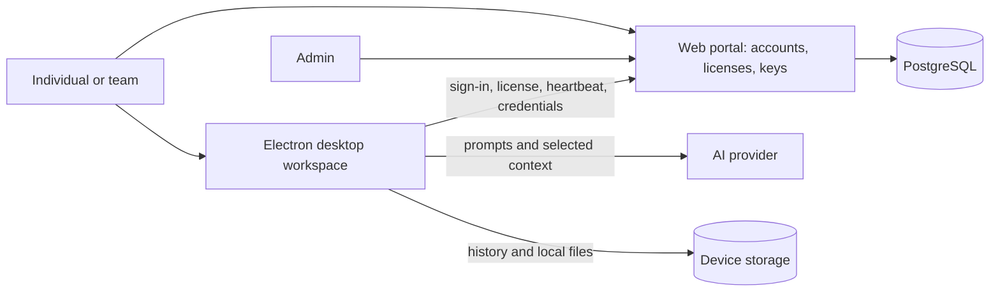
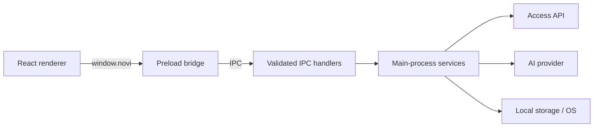

# Novi

A desktop AI workspace and a separate web portal for access management. People use Novi to work with AI, documents, audio, and local projects. Individuals can register on the website; desktop use requires an active license and a configured AI connection.


The portal controls **who can use Novi and which features they can access**. The desktop app provides the workspace and sends AI requests to the selected provider. The animation is a simplified overview; the diagrams below show the trust boundaries and data paths.

**Start here:** [Run locally](#run) · [Business flow](#how-the-product-fits-together) · [Code map](#code-map-for-new-developers-and-agents) · [Web portal guide](webapp/README.md) · [Data and privacy](#where-data-lives) · [Verification](#verification-and-current-limits)

## How the product fits together



1. An individual signs up or an administrator creates an account. An active license determines desktop access and plan features. Enterprise and legacy team accounts follow the owner hierarchy described in the [portal guide](webapp/README.md#account-rules).
2. The owner configures provider credentials in the portal. After desktop sign-in, the access service supplies eligible credentials to Electron's main process; the renderer receives connection metadata.
3. A user chooses a model and can start a conversation, load context documents, listen to audio, or use plan-dependent tools. The desktop sends selected content to the chosen AI provider. Local Coding works on a captured project snapshot and produces proposals, not edits to the original project.
4. The desktop checks in periodically. Revocation and license changes are applied through the access service. History and related workspace data live on the device; the web database stores access-management data.

## Code map for new developers and agents

| Area | Start here | Responsibility |
| --- | --- | --- |
| Desktop lifecycle | [main.ts](src/main/main.ts) | Electron startup, windows, permissions, and renderer network boundary. |
| Desktop bridge | [preload.ts](src/main/preload.ts), [handlers.ts](src/main/ipc/handlers.ts), [types.ts](src/shared/types.ts) | Named renderer API, IPC validation and shared contracts. Follow a call through all three when changing the bridge. |
| Desktop interface | [renderer source](src/renderer/src) | React pages, components, hooks, UI state and capture flows. |
| Desktop behavior | [main services](src/main/services) | Authentication, provider requests, storage, sessions, audio, local coding, and platform integrations. |
| Shared rules | [shared](src/shared) | Types, provider definitions, plans and session modes used across boundaries. |
| Website and backend | [webapp](webapp/README.md) | Next.js pages, access API, Prisma schema and migrations. |
| Checks | [tests](tests), [webapp/tests](webapp/tests) | Desktop service and UI checks; portal access, route and release checks. |



For a change, trace the UI action through the preload contract, IPC handler, service and shared types; update the corresponding tests. Access and feature rules also cross into the portal and [shared plans](src/shared/plans.ts). Start with existing behavior and tests, and treat the source and migrations as authoritative when documentation differs. The [architecture notes](docs/existing-architecture.md) describe an earlier baseline and are historical, not a current specification.


## Run

Requires Node.js **22.18+** (Node 24 recommended), npm, and a desktop session.

```sh
npm install
npm --prefix webapp install
npm run web:setup
npm run web:dev
# In a second terminal:
npm run dev
```

On Windows, if PowerShell blocks `npm.ps1`, use `npm.cmd install` and `npm.cmd run dev`.

After the one-time dependency installation and `npm run web:setup`, use the combined launchers from any directory:

| Action | Windows | macOS / Linux / Git Bash |
| --- | --- | --- |
| Develop web frontend/backend + Electron | `scripts\dev.bat` | `sh scripts/dev.sh` |
| Build both apps | `scripts\build.bat` | `sh scripts/build.sh` |
| Build, then run both production apps | `scripts\build-and-run.bat` | `sh scripts/build-and-run.sh` |

Each launcher opens two independent terminal windows: **Web frontend + backend** (Next.js) and **Electron**. Build output and errors stay in their respective terminals. Electron waits for the web server before starting. Use Ctrl+C in each terminal to stop that app; stopping one does not close the other. Default portal URL: `http://localhost:3000`. Set `NOVI_PORT` (or `ASTRA_PORT`) to change the port; the launcher configures the matching desktop URL and portal origin automatically. It fails if another server already occupies the port. Building does not migrate or reset a database. Interrupted desktop processes release their server lease after 90 seconds.

Windows uses PowerShell windows; macOS uses Terminal; Linux uses an installed terminal emulator (x-terminal-emulator, GNOME Terminal, Konsole, XFCE Terminal, or xterm). On a headless system, open two shells manually and run `node scripts/run.mjs dev --app web` and `node scripts/run.mjs dev --app electron`. Replace `dev` with `build` or `build-and-run` as needed. `node scripts/run.mjs dev` retains the combined single-terminal workflow.

```sh
npm run build       # Type-check and produce out/main, out/preload, out/renderer
npm start           # Launch the production build
npm test            # Dependency-free core checks, using Node's test runner
npm run test:desktop # Build and exercise the real Electron app with a local API fixture
```

`npm run build` creates runnable application assets, not an installer. Installers come from `npx electron-builder`, and the release workflow (`.github/workflows/build.yml`) builds and publishes them for macOS, Windows and Linux when a `v*` tag is pushed. Installed copies find new releases in **Settings › General › Updates**, with **Check for updates** or automatically at startup, and install them with **Update & Restart**. Installers are not code-signed. Release notes are plain text that users read in **Settings › General › Updates**: type them in the portal's release form, or, for a tag pushed from a terminal, commit them first as `release-notes/vX.Y.Z.md`. Dependencies must be downloaded by `npm install` before building.

## Mask and terminal controls

In **Settings › General › Mask**, turn on **Mask Novi**, choose a window name, and optionally pick an application or an image with **Choose icon…**. Click **Save mask settings**. This device setting also applies before sign-in and to newly opened windows. Turn Mask off to restore the usual titles and icons. Windows cannot be minimized while Transparent mode is enabled. A masked window has no taskbar entry, so after minimizing it, open Novi again to bring it back. The Windows taskbar and macOS Dock can be hidden; Linux desktop support varies. This does not hide processes from Task Manager, Activity Monitor, system tools, or change the installed executable's identity. File icon extraction can return a generic icon; PNG/ICO files provide a predictable alternative on Windows/Linux.

In an installed build, **Settings › General › Terminal command** shows whether the terminal command is missing, current, or needs updating. Use **Install terminal command**, **Update terminal command**, or **Add command to PATH** as shown. Novi adds its command directory to the Windows user PATH or your bash/zsh/sh/fish profile and refreshes the status. Open a new terminal afterwards; some terminal apps must be fully quit and reopened. Existing terminal processes retain their old environment. **Check again** refreshes the status:

```sh
novi start # Launch or restore the main window, including while masked
novi show  # Show/restore Novi, or launch it if it is not running
novi stop  # Quit all windows through normal shutdown cleanup
```

To use the command immediately after installation in an already-open shell:

```sh
# bash, zsh, sh, dash, or ksh (current shell only)
export PATH="$HOME/.local/bin:$PATH"
hash -r

# fish (current shell only)
fish_add_path "$HOME/.local/bin"
```

```powershell
# Windows PowerShell: reload persisted machine and user PATH for this shell
$env:Path = [Environment]::GetEnvironmentVariable('Path', 'Machine') + ';' + [Environment]::GetEnvironmentVariable('Path', 'User')
```

For Windows Command Prompt, reopen the terminal app, or use `set "PATH=%APPDATA%\Novi\bin;%PATH%"` for that shell. Novi cannot refresh the environment of an existing parent shell. **Check again** checks installation; it does not reload your terminal. Automatic Unix profile setup follows your configured shell; a different shell may need its own PATH setup.

The launcher requires no separate Node.js installation. Use **Update terminal command** if you move Novi or its AppImage. With a built development checkout, use `npx electron . start` and `npx electron . stop`. Commands address the instance using the same user-data directory (`NOVI_DATA_DIR`, if set). Stopping an already stopped app does not open a window. **Quit Novi** is in **Settings › General › Data & account**; quitting stops active work, and unsent text is not saved. While you are signed in, Novi asks before closing its window (the close button, Alt+F4, Ctrl+W or Cmd+W, or the taskbar), quitting from Settings, or signing out. `novi stop`, the Quit shortcut (Cmd+Q on macOS, Ctrl+Q on Linux), updates and shutting down the computer quit without asking.

## First launch

### Context sessions

After sign-in, Novi shows **Get ready** (below) and then **Session setup**, not the conversation screen. Setup has three steps:

1. **Model**: choose the AI connection and model. Saved profiles can be started here in one click, and **Start an empty chat instead** skips setup and opens a plain chat.
2. **Documents** (optional): **Choose folders** of resumes, job descriptions or notes.
3. **Instructions**: the purpose fills itself in from your choices (edit it to use your own words), then pick a **Session type** and optionally add a company, a role and a preset. A preset applies as soon as you click it, and **Undo** puts back what it changed. **More options** holds the four answer instructions and **Save profile**.

**Start session** stays pressable while something is missing and takes you to it instead. It opens chat and sends all selected text plus the instructions to that provider. The first assistant response confirms/summarizes the reference material and becomes `AI Context.md`.

During a session the window docks full height on the right of the working monitor (about a third of the screen wide, at most 1000 px). The message box starts attached below the conversation, with attachment, snapshot, listening, mode, model and other controls in the toolbar above it; only Send (or Stop while generating) sits beside the text. **Detach controls** moves the same controls into a floating window, and **Attach controls** returns them to the chat. Drafts, attachments and active listening are preserved. Closing the floating window also reattaches the controls. Drag the floating tray's background to move it; drag either side grip to change its width, or focus a grip and use the arrow keys. Controls wrap to fit, and the floating tray automatically trims unused height after resizing or closing menus. Both layouts follow transparent mode and click-through. Ending the session closes any floating tray and restores the window.

**Get ready** checks everything in one click: app storage, the AI connection, speech files, microphone, system audio and screen capture. It opens by itself once per launch for each account. Results are remembered on this computer for the rest of the day, and **Continue anyway** is always available. To run it again later, use **Run Get ready** at the top of session setup. Under **More options** on the setup's last step, **Save profile** keeps the model, folders, session type, framework, company, role and instructions; next time, **Start** on the profile begins that session in one click, reading the folders again so updated files are used. At the start of a session, a ready check in the panel lists the results and the main shortcuts, names anything that isn't ready yet, and offers a one-minute **practice run**: Novi plays a sample interviewer question so you can try listen, stop, send and read once before it counts. It sends one question to your AI model.

**Local Coding** is a separate mode for questions about a project on your computer. Choose a working folder (type its path or browse with Novi's own explorer), optionally add files or folders, and pick an agent: **Codex** (needs an OpenAI connection on `https://api.openai.com/v1`), **Claude** (needs an Anthropic connection on `https://api.anthropic.com/v1`), or **Antigravity (agy)** (needs a Gemini connection on `https://generativelanguage.googleapis.com/v1beta`). Under **Settings › API Management › Local Coding agents**, Novi checks installed versions and offers **Install** for missing engines, **Check for updates**, and **Update** when a newer release is available. Installs are managed inside Novi’s user-data directory and use the publishers’ official downloads. **Test API key** checks that the selected saved key can list models; it does not test a model reply. **Get ready** tests a reply from the model selected in session setup. If that model returns 404, use **Choose another model**, refresh the list, and retry with a different model. Agents use the saved key automatically without browser sign-in. Antigravity does not accept screenshots. Novi captures the eligible text files into its own storage as **Local S0**, excluding dependencies, build output, version-control internals, credential files and binaries, and shows what it included. The agent reads only that captured copy, through three read-only tools (list, search, read); it has no shell, no file editing and no web access, and the project folder is never written. Each coding answer is validated and becomes an **iteration**: a virtual version with clickable EDIT, NEW and DELETE cards that open a diff in the viewer (unified or side by side, against the parent or the local snapshot, with copy actions). The selected version is what the next request reads, so you can continue from Iteration 1 or branch from it. **Capture latest local files** takes a new snapshot; **Refresh and carry forward** combines your latest files with the selected iteration and asks you to choose when both changed the same file. Selected files are sent to the agent's provider when it reads them. Proposals are never run or tested.

TXT files must be UTF-8. PDF.js extracts searchable PDF text locally (including page labels); no PDF upload service is used. Scanned/image-only or encrypted PDFs are rejected, and diagrams/layout are not interpreted. Limits: 8 folders, 30 files, 10 MB per file, 50 MB total, and 200 pages per PDF. There is no extracted-character limit. Subfolders are included; symlinks are skipped. Oversized files are rejected, never silently truncated. The selected model still imposes its own context window and provider charges.

Session setup includes question presets for any role (introductions, concepts, coding, design, behavioral stories, project walkthroughs, and quick follow-ups), plus the existing role-specific presets. The **Answer vocabulary** slider selects Plain, Everyday, or Technical wording for the session and is saved with profiles. Typing and sending remain available while listening starts or stops; sending a message keeps listening active.

Conversations, attachments, and the full text of loaded reference documents are saved to the signed-in account's local history. Reference text is unencrypted in `data.json`, stored once and shared by the conversations that use it; it remains after ending a session. Delete every conversation that uses a reference, or clear history, to remove that reference from app storage. New conversations inherit the session's references and initial AI summary. The model is fixed for that session. `AI Context.md` is stored at `<Electron userData>/context-session/AI Context.md`; it is deleted on **End session**, sign-out, normal app close, or the next launch after an interrupted exit. Saved images remain until their conversation is deleted or history is cleared. Source folders are not deleted. Deletion is ordinary local deletion, not forensic secure erasure; it cannot remove exports, backups, or provider-side records. Saved profiles store folder locations and instructions, never the documents' text. History format 3 reads and migrates formats 1 and 2; older Novi builds cannot read the new format.

PDF support requires `npm install` to install `pdfjs-dist` and its platform dependencies. If it is missing, TXT sessions still work and PDF loading explains the install requirement. If a context request fails or is stopped, **Retry session setup** sends the same loaded documents and instructions again. End the session to choose different files or another model. Calibration is independent of context: enabling Eye Track starts the 25-target calibration; ending a context session also stops its tracking/HUD.

1. Open the web portal at `http://localhost:3000`. Local setup writes generated passwords to the ignored `webapp/.env.access` file.
2. Sign in as `admin` with `ADMIN_PASSWORD`. Create an individual or enterprise account; enterprises can create groups. Individuals can also register themselves on the website.
3. Issue a Core, Pro, Ultimate, or Lifetime license. An individual uses one account and password on web and desktop; the license attaches directly to that account. Enterprise groups create managed desktop accounts and bind their team licenses as before.
4. As the owner, add provider keys and model IDs in **API management**.
5. In Electron, sign in with the licensed desktop username and password. Open **Settings › API Management** to enable and select inherited connections.

The optional seeded individual `individual` works on both web and desktop with `DEMO_PASSWORD`. Enterprise/legacy desktop accounts are `standalone.desktop` and `studio.desktop`; portal team owners are `standalone` (legacy), `corporation`, and `subcorp`. See [webapp/README.md](webapp/README.md) for the role matrix, schema, API, and deployment instructions.

The desktop reads `NOVI_ACCESS_URL` from its launch environment (defaults to `http://localhost:3000`). On PowerShell: `$env:NOVI_ACCESS_URL='https://your-access-server.example'`. Production servers require HTTPS. **Sign out** is in **Settings › General › Data & account**. Signing out releases the account immediately; crashed devices lose their lease after 90 seconds. If the server becomes unreachable, the session stays open and local features keep working; sending to an AI provider needs the server. After 90 seconds offline, Novi shows a reconnecting notice. Only a server rejection (revocation, password reset, license termination, another device signing in, or the 8-hour sign-in limit) ends the session.

The managed provider catalog supports OpenAI, Anthropic, Gemini, and Kimi (Moonshot AI). Owners supply a model ID available to their provider account. Compatible providers use the existing Chat Completions transport; provider destinations are fixed by the server. Redirects are rejected.

Image messages require a vision-capable model. Desktop accounts can select and disable connections; editing keys, destinations, and model IDs is restricted to the web owner portal.

## Phone companion

The QR code button in Novi's title bar (**Open phone companion**) shows a link and QR code that let a phone control Novi. Its small web server starts only when you open it. Choose **Same Wi-Fi** to connect directly over your local network, or **Anywhere** to go through a Cloudflare tunnel (HTTPS); with Anywhere on, Novi accepts only connections that come through the tunnel. A new link is made each time the companion starts or switches between the two, so old links stop working. Signing out disconnects the phone.

## Architecture

### Local speech

**Settings › Local AI** shows this computer's hardware and manages local speech
models: checksum-verified, resumable downloads, deletion, and a **Live test**.
During a session, the microphone button in the tray (or the listen shortcut)
transcribes what Novi hears. In the tray's audio settings, **Audio input**
chooses system audio, your microphone, or both, and **Transcription** is
**Local** by default, which keeps the audio on this computer; **Cloud** sends it
to your AI provider instead. Local LLM analysis and offline account access are
not enabled yet. See [implementation status](docs/local-ai.md) and
[inspected architecture](docs/existing-architecture.md).

Run the dependency-free model checks with `npm run test:local-models`.

Desktop packages include the lightweight English streaming speech model, neural
VAD, the native speech runtime, and Cloudflared. The packaging hook downloads and
verifies pinned assets, checks the target native addon, and smoke-tests speech
and VAD on the build host. Packaging needs internet access; speech files are
copied into each user's model storage on first setup without a download. Larger
speech models, speaker detection, and local LLM weights remain optional.

The detached code/diagram viewer stays scrollable even when the main window passes clicks through.

```text
src/
  main/
    main.ts                 Window, sandbox, network and navigation restrictions
    preload.ts              Typed, allowlisted IPC bridge
    ipc/handlers.ts         Sender validation, input validation, session scoping
    services/
      managedAuth.ts        JWT login, remembered session, license heartbeat
      auth.ts               Legacy local implementation, no desktop IPC exposure
      storage.ts            Atomic local JSON persistence
      credentials.ts        OS-backed encrypted credentials, bound to endpoint
      providers.ts          AIProvider, factory, OpenAI and compatible providers
      chat.ts               Conversation lifecycle, streaming, cancellation
      images.ts             Native-image validation and local image management
      validation.ts         Shared main-process request validation
  renderer/src/
    App.tsx                 Session routing, theme, error boundary
    pages/                  Auth, onboarding, chat, settings
    components/             Brand, provider controls, sidebar, messages, composer
    hooks/useChat.ts         Conversation state and stream subscriptions
    services/api.ts         Typed IPC result handling
    styles/app.css          Responsive desktop layout and light/dark themes
  shared/types.ts           Public types and IPC contract; no API-key getter
tests/core.test.ts          Authentication, validation, SSE, provider checks
scripts/smoke.ts            Desktop integration flow and screenshots
```

React never calls an AI endpoint or reads a file directly. It invokes named preload functions, which route validated requests to main-process services. The main process owns history, credentials, image access, and provider traffic. React uses component state and a dedicated chat hook; a global state dependency is unnecessary at this size.

Both providers implement `AIProvider.sendMessage()`. They share the Chat Completions wire format, including image data URLs and streaming server-sent events. Requests use Node's built-in `fetch` and `AbortController`; no proxy server or provider SDK is required. The response callback supports progressive updates, and the returned response supports non-streaming operation.

## Where data lives

Novi uses Electron's `app.getPath('userData')`, typically:

| Platform | Directory |
| --- | --- |
| Windows | `%APPDATA%/Novi` |
| macOS | `~/Library/Application Support/Novi` |
| Linux | `$XDG_CONFIG_HOME/Novi` or `~/.config/Novi` |

The exact directory follows Electron's platform conventions. `NOVI_DATA_DIR` can override it for isolated testing; do not point it at an unrelated application's directory.

- `data.json`: local account caches, display preferences, provider metadata, selection, theme, and existing history. Managed passwords and API secrets are never written here. This file is **not encrypted**.
- `access-session.json`: the desktop session token, its access server, an installation identifier, and (when selected) the remembered username plus an OS-encrypted password for sign-in autofill. The app still checks the session with the server, and closing Novi ends the desktop session. Password saving is optional and requires the system credential store; on Linux, unlock a supported keyring first. The encrypted password is bound to its username and access server.
- Managed provider secrets stay in main-process memory and are cleared on sign-out. The renderer receives metadata only. Local `credentials.json` keys are stored in app data without a keychain; older encrypted keys remain preserved but must be re-entered before use.
- `images/`: app-owned local copies of attached images, addressed by generated IDs rather than renderer-provided filesystem paths. Copies preserve history if an original file moves. Deleting conversations or clearing history removes unreferenced copies. Unsent copies are pruned on sign-out or next startup.

The active desktop session token and local API keys do not require an OS keychain. They are stored in app data, protected by that directory's OS account permissions. Anyone with access to the files can use those secrets until the app signs out or they are revoked. Saved passwords use the OS credential store separately.

The backend encrypts managed API keys with AES-256-GCM. Desktop credentials are bound to the provider endpoint and cannot be redirected through renderer IPC.

The backend checks account hierarchy, account status, license expiry, and the current device session on authenticated requests. Admin password resets revoke sessions. Local file edits cannot grant a server session. Local history still depends on OS account security and disk encryption.

Each license has a plan, and the app unlocks only what that plan includes (the table is in `src/shared/plans.ts`, shared with the server). Core has the Technical Screen and Behavioral Interview modes. Pro and Lifetime add Chat, Recruiter Call, Code, System Design and eye tracking. Ultimate adds Local Coding and the phone companion. Everything else is on every plan. Every check-in returns the plan's features. Locked features stay visible with a lock, and the main process refuses them (sending in a locked mode, Local Coding, the eye-tracking overlay, diagram repair, the phone companion), so hiding a button is never the only check. A plan change reaches the app at its next check-in, about 20 seconds; a downgrade stops the phone companion and closes the eye-tracking overlay. The app sends `x-novi-plans: 1` on every request. Versions from before plans don't, unlock everything, and are therefore refused on any license except Ultimate. Enforcement runs in the app, which holds the provider keys, so a modified app could bypass it; fully tamper-proof gating would need AI requests to go through the server.

## Add another AI provider

1. Add a provider ID to `ProviderKind` in `src/shared/types.ts`.
2. Implement `AIProvider.sendMessage()` in a main-process service. Accept the abort signal, adapt message/image input to the provider's format, call `onDelta()` for streamed chunks, and return final text. Map errors to safe `UserError` messages.
3. Register the implementation in `AIProviderFactory.create()`.
4. Extend `settingsInput()` validation and `ProviderFields` for that provider's configuration.
5. Add a protocol test in `tests/core.test.ts`.

To add a managed provider, extend the web catalog in `webapp/src/lib/access-policy.ts` and map it to a desktop transport in `src/shared/providers.ts` if a new protocol is needed.

## Security and privacy

- Sandboxed renderer; `contextIsolation: true`, `nodeIntegration: false`, `webSecurity: true`.
- Only named functions cross the preload bridge; no raw IPC, Node.js, arbitrary file reads, shell access, or API-key readback.
- IPC requires the app's trusted top-level renderer URL. Inputs and per-account ownership are checked in main.
- Content Security Policy, blocked navigation/popups/webviews, denied permissions, and blocked external renderer networking.
- Markdown HTML is disabled. Remote Markdown images are not fetched, and response links are rendered as inert text so model output cannot trigger network requests.
- PNG/JPEG/WEBP uploads are checked by extension, signature, and native decoding. Multiple images can be attached; each imported file must be 8 MB or smaller and under 40 megapixels.
- Messages and image data go directly to the selected provider when sending. Novi has no analytics, cloud storage, or background uploads. The chosen provider's own retention policy still applies.
- To shorten the wait for an answer, Novi opens a connection to the selected provider shortly before a likely request (while you type, take a screenshot, stop listening, or send). This is an unauthenticated `GET …/models` request that carries no API key, message, or file content.
- Technical development logs contain operation/error categories, not provider response bodies or credentials.

## Verification and current limits

Core checks use the installed `tsx` runner and cover URL/input validation, session persistence, account separation, SSE, provider errors, and the managed auth/credential boundary. `npm --prefix webapp run test:access` builds a temporary schema from the real migrations in the disposable PostgreSQL database named by `TEST_DATABASE_URL` (it skips without one) and checks permissions, license immutability, inheritance, revocation, and device exclusivity.

The desktop smoke script exercises managed sign-in, read-only provider selection, context loading, image chat, cleanup, and sign-out against a local fixture. It does not call a real AI provider.

Both production builds and the portal browser checks were verified. The native Electron smoke launch crashes in this environment (`Target crashed`, GPU process exit `-1073741515`), so native UI verification requires rerunning `npm run test:desktop` on a working desktop runtime. No live paid-provider request was made.

Other deliberate version-one limits:

- One active generation per application window; requests time out after three minutes.
- History uses a small atomic JSON store; very large histories will eventually benefit from SQLite and pagination. No automatic context truncation is performed.
- A response is saved when it finishes or stops. A crash during generation may lose that partial response; the user's submitted message is already saved.
- Code blocks are styled monospace with a Copy button; token-level syntax highlighting is not included.
- Image thumbnails are local. Temporary unused image copies are bounded; after many unused selections, signing out clears them.
- No web browsing, plugins, cloud sync, or autonomous actions. Local Coding agents read only a captured copy of your files, and their proposals are never run.

Implementation references: [Electron security](https://www.electronjs.org/docs/latest/tutorial/security), [OpenAI image inputs](https://developers.openai.com/api/docs/guides/images-vision), and [OpenAI streaming](https://developers.openai.com/api/docs/guides/streaming-responses).
