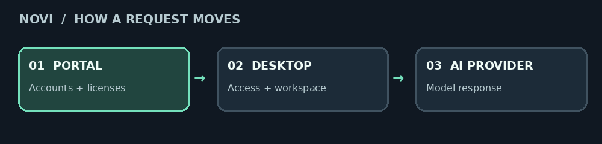
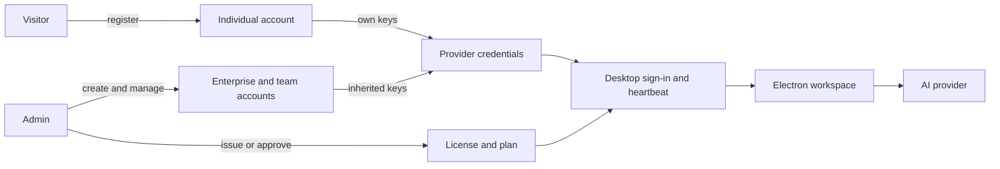
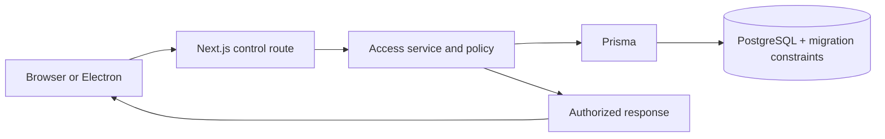

# Novi web portal and access backend

The portal is Novi's public website, account dashboard, and access server. It manages identities, licenses, sessions, and provider credentials for the separate Electron workspace. It uses Next.js, Prisma, and PostgreSQL. Individuals can register themselves; enterprise accounts and their hierarchy remain managed.



**Navigate:** [Local setup](#local-setup) · [Business flow](#business-flow) · [Code map](#code-map) · [Account rules](#account-rules) · [API](#backend-endpoints) · [Deployment and checks](#deployment-and-checks) · [Desktop guide](../README.md)

## Business flow



Registration creates a portal account, not paid access. An administrator issues a license or approves a request; owners configure provider keys. Individuals use their own account and keys. Team desktop accounts inherit credentials according to their hierarchy. The desktop validates access with this backend and sends AI requests to the provider. Purchase requests are administrative workflows; there is no card payment integration.

## Code map

| Location | What to follow |
| --- | --- |
| [src/app](src/app) | App Router pages, public site and API routes. |
| [src/components](src/components) | Landing page and management dashboard UI. |
| [control route](src/app/api/control/%5B...path%5D/route.ts) | HTTP entry point for access operations, request validation and dispatch. |
| [access.ts](src/lib/access.ts) | Account, authentication, session, license, credential and request operations. |
| [access-policy.ts](src/lib/access-policy.ts), [access-permissions.ts](src/lib/access-permissions.ts), [access-security.ts](src/lib/access-security.ts) | Business policy, authorization and security helpers. |
| [schema.prisma](prisma/schema.prisma), [migrations](prisma/migrations) | Current and legacy data models; migration SQL also enforces invariants. |
| [tests](tests) | Route, business-rule, concurrency, release and site checks. |
| [shared plans](../src/shared/plans.ts) | Plan definitions consumed across the desktop and portal. |



When changing an operation, follow the request from the route through access and permission checks to the schema and migrations, then check the relevant tests and desktop caller. `webapp/AGENTS.md` contains the local agent instructions. Legacy `/api/v1` routes are retired; see [Backend endpoints](#backend-endpoints).

## Local setup

From the repository root (use `npm.cmd` if PowerShell blocks npm scripts):

```sh
npm --prefix webapp install
npm run web:setup
npm run web:dev
# A second terminal, for Electron:
npm run dev
```

Open http://localhost:3000. The first setup run creates `webapp/.env.access` with generated secrets and passwords, then stops: put a separate development PostgreSQL database (for example a second, free Supabase project) in its `DATABASE_URL` and `DIRECT_URL`, and run setup again to migrate it and seed sample accounts. Never use the production database: setup adds demo accounts. Setup reads the database only from `.env.access`, never from your shell. Running setup again preserves passwords and license assignments, and setup never touches local desktop history.

| Identity | Username | Password source |
| --- | --- | --- |
| Administrator | `admin` | `ADMIN_PASSWORD` in `.env.access` |
| Individual (web + desktop) | `individual` | `DEMO_PASSWORD` |
| Legacy team owner | `standalone` | `DEMO_PASSWORD` |
| Corporation | `corporation` | `DEMO_PASSWORD` |
| Sub-corporation | `subcorp` | `DEMO_PASSWORD` |
| Legacy team desktop | `standalone.desktop` | `DEMO_PASSWORD` |
| Sub-corporation desktop | `studio.desktop` | `DEMO_PASSWORD` |

These passwords are generated locally, never committed or displayed in the sign-in page. Individuals use the same username and password on the web and desktop. Enterprise/legacy desktop accounts remain Electron-only; enterprise owners use the portal. Seeded owners have no real provider keys: add a provider credential before using AI.

## Account rules

```text
Administrator (one)
├── Individual → same web + desktop login, directly attached license
├── Legacy standalone team owner (existing accounts preserved)
│   └── Licensed desktop accounts → one active device each
└── Enterprise / Corporation
    └── Sub-corporations
        └── Licensed desktop accounts → one active device each
```

| Role | Creates | Manages API keys | Desktop eligible |
| --- | --- | --- | --- |
| Admin | All other account types | No | No |
| Individual (`INDIVIDUAL`) | None | Own keys | Yes, with active license |
| Legacy standalone (`STANDALONE`) | Own licensed accounts | Own keys | No |
| Corporation | Own sub-corporations | Own keys | No |
| Sub-corporation | Own licensed accounts | Own keys | No |
| Licensed account | None | Read-only inherited connections | Yes |

The admin can edit usernames/names, suspend/reactivate accounts, reset anyone's password (including their own), and delete account branches. Corporations can reset passwords for their sub-corporations and licensed desktop descendants; sub-corporations can reset passwords for their licensed desktop accounts. Deletion is permanent soft deletion: descendants and licenses are disabled, sessions revoked, and historical assignments retained. Roles and parent relationships cannot be changed. Search by username, filter by type/parent, or inspect the expandable organization tree with online devices. The admin can end device sessions from the user list.

## Licenses and purchase requests

Keys are generated with cryptographic randomness in `XXXX-XXXX-XXXX-XXXX` format. An individual license binds directly to the individual account when issued or when a request is approved. An individual has one license, no child accounts, and a request quantity of one. Renew or change that license instead of issuing another. Enterprise and legacy team licenses bind permanently when the owner creates a desktop account. Each licensed account has one license. Database constraints and triggers prevent reassignment, owner changes, key changes, deletion, and revival of terminated licenses. **Use migrations, not `prisma db push`, because the triggers and partial unique admin index are part of the migration.**

Admin renewal accepts days, calendar months, or calendar years; it extends from the later of now and the current expiry. Month/year extensions clamp to the last valid calendar day. Termination is irreversible. The portal shows plan, expiry, remaining days, assignment, and current status.

### Plans

Every license has a plan: Core, Pro, Ultimate or Lifetime. The plan decides what the desktop app unlocks; the table lives in `src/shared/plans.ts` and is shared by the server and the app:

| Plan | Unlocks |
| --- | --- |
| Core | Technical Screen and Behavioral Interview modes, plus everything that is on every plan (documents, screenshots, listening, transparency, shortcuts, smart placement, Practice run, Get ready) |
| Pro | Core, plus Chat, Recruiter Call, Code and System Design modes, diagram repair and eye tracking |
| Ultimate | Pro, plus Local Coding and the phone companion |
| Lifetime | The Pro features, and it never expires |

- **Issuing** requires a plan. Lifetime takes no term: it is stored with a far-future expiry (9999-12-31) and shows as "Never".
- **Change plan** (admin, `PATCH licenses/:id` with `action: "plan"`) keeps the expiry between Core, Pro and Ultimate. Moving to Lifetime removes the expiry. Leaving Lifetime needs a new term counted from today. Terminated licenses can't change plan, and Lifetime licenses can't be renewed. Changes are recorded in Activity as "License plan changed".
- **The desktop app picks up a plan change at its next check-in** (about 20 seconds), with no sign-in. Locked features stay visible with a lock and the plans that include them, and the main process refuses them. A downgrade stops the phone companion and closes the eye-tracking overlay.
- **Purchase requests** carry a plan. Lifetime requests store no term (`duration 0`, `unit LIFETIME`), and approval issues every license on the requested plan.
- **Desktop apps from before plans** unlock everything and don't send the `x-novi-plans: 1` header. The server lets them use Ultimate licenses only, which include everything anyway. On any other plan they are refused at sign-in and at the next check-in, which also frees the device so the updated app can sign in at once. The message points to `/download`, because old apps show their updater only after sign-in.
- **Database rules:** the `plan` column only accepts the four plan ids (a CHECK constraint in the `license_plans` migration). Rows that existed before plans became Ultimate, and the column keeps that default only so the previous site version can still issue licenses while a deploy is in progress. The API always sets the plan itself.
- **Limit:** enforcement runs in the desktop app, which holds the provider keys, so a modified app could bypass it. Fully tamper-proof gating would need AI requests to go through the server.

The license inventory groups by owner by default, with assigned/unassigned views, owner/account/status filters, and search across keys, names, and usernames. Sort by owner, assigned account, expiry, or issue date. Pagination shows 20 rows by default (50/100 optional); filtering and sorting apply to the full authorized inventory before pagination. License data still comes from the existing workspace state endpoint.

Activity shows only account and license changes, including password resets and licenses issued through approved requests. Sign-ins, sessions, API keys, and unfulfilled requests are excluded from the view; audit records are retained. Its admin-only endpoint filters the complete history before returning 20 events per page, with event type, inclusive date/time range, and newest/oldest ordering. Date inputs use the browser's local time zone and include the entire ending minute.

Purchases use admin-approved requests with quantity, plan and term. Approval atomically issues the requested licenses on that plan; a request cannot be fulfilled twice. This implementation does not charge cards or imply a successful payment. Automated checkout requires a payment provider, pricing, and verified payment webhooks.

The public purchase preview lets visitors choose a plan, enter contact details, review pricing, and continue to a final help screen: “Online payment isn't ready yet. Call MUKUL KAWADI WALA, the developer, for help.” Its email handoff supports manual access. It collects no payment details and never creates accounts or licenses. The proposed manual and automatic license logic is in [docs/license-flow.md](../docs/license-flow.md).

## Individual signup and database rollout

`/#signup` creates an `INDIVIDUAL` account with a username, name, and password, then signs it into the website. `POST /api/control/register` ignores caller-supplied role, parent, plan, license, and audience fields. Signup creates no paid access and is limited to five attempts per trusted client IP every 15 minutes using database counters. Password recovery remains through the administrator/support; no email verification or email reset service is connected.

Admin **Create account** defaults to Individual and also offers Enterprise, Enterprise group, and Enterprise desktop account. Existing `STANDALONE` accounts retain their hierarchy, credentials, passwords, and bindings as legacy team owners. They are not merged or relabeled as individual accounts because that would break existing desktop logins.

Deploy `20261027150000_individual_accounts` with `npm run db:deploy` before enabling the new signup UI. The migration adds database guards: individuals are roots, cannot have children, and must own the license bound to themselves. The existing unique `accountId` prevents two concurrent grants to the same individual. No existing rows are changed or removed. An individual can end their own desktop session from the web dashboard, and web access remains available after license expiry or termination so they can arrange help. Termination still permanently closes that license.

## Sessions and JWTs

Passwords use bcrypt with cost 12, a 12-character minimum, and a 72-byte maximum. Usernames are case-insensitive. Sign-in attempts are throttled in the database (10 per address/account and 50 per account every 15 minutes). Signup has its own per-address counter.

JWTs use HS256, an explicit issuer, an 8-hour expiry, and separate `portal` / `desktop` audiences. JWT subjects and session IDs are checked against the database on every authenticated backend request; roles and access are taken from live records. The web token is in an HttpOnly, SameSite=Lax cookie (Secure in production). Mutations require JSON and validate browser Origin. Tokens are never kept in browser localStorage. Desktop JWTs stay in Electron main. "Keep me signed in" saves the token in app data, protected by the OS account's file permissions (there is no keychain).

A unique nullable `activeSlot` in `AccessSession` atomically reserves each desktop account. Password-only login cannot replace a live session, even with the same device identifier. Electron sends a heartbeat every 20 seconds. A session with no heartbeat for 90 seconds loses its lease, so another device may sign in; until one does, the same session can resume after a network outage. Sign-out and normal app exit release it. Admin resets, suspension, deletion, termination, and session revocation invalidate access. Active desktop work stops at the next validation/heartbeat (up to roughly 20 seconds plus network timeout); new sends validate before contacting the provider. An unreachable server never ends a desktop session. Sessions require sign-in again after 8 hours; there is no unlimited refresh-token lifetime or offline license mode.

## API management

Owners can add multiple keys per provider, rename/rotate/remove them, and specify a model. Available providers: OpenAI, Anthropic, Gemini, and Kimi (Moonshot AI). Keys saved for retired providers are no longer delivered to desktop accounts. API secrets use AES-256-GCM with a separate 32-byte server key. Portal responses contain metadata and the last four characters only.

Individuals use the keys saved on their own account. Legacy standalone desktop accounts inherit the team owner's keys. Sub-corporation desktop accounts inherit both sub-corporation and parent corporation keys. Credentials are delivered over the authenticated desktop API into Electron main-process memory; the renderer receives only nickname, owner, provider, model, and availability. Settings has separate General and API management tabs. Desktop users can enable/disable connections and select one active connection; they cannot add/edit/delete owner keys or change destinations. Changes sync on heartbeat or Refresh. This is a managed credential distribution design; a server-side inference gateway would be needed if secrets must never reach the user's machine.

## Backend endpoints

All paths use `/api/control/`. Success responses are `{ data: ... }`, failures `{ error: string }` with an appropriate HTTP status.

| Endpoint | Methods | Purpose |
| --- | --- | --- |
| `register` | POST | Public individual signup; unlicensed account plus portal cookie |
| `login` | POST | Username/password, portal role or desktop audience/device metadata |
| `logout` | POST | Revoke current session |
| `state` | GET | Authorized portal account tree, licenses, devices, requests, masked keys |
| `activity` | GET | Admin account/license audit history; `page`, `event`, `sort=asc\|desc`, `from`/`to` as ISO timestamps with time zone; 20 per page |
| `desktop` | GET | Validate license, renew heartbeat, return the license plan, its features and inherited credentials to main |
| `accounts` | POST | Create authorized account; desktop creation binds license atomically |
| `accounts/:id` | PATCH, DELETE | Admin edit, password reset, status, permanent branch deletion |
| `licenses` | POST | Admin issuance with a plan |
| `licenses/:id` | PATCH | Admin renewal, plan change, or termination |
| `sessions/:id` | DELETE | Admin or individual ending their own desktop session; force logout |
| `credentials` | POST | Owner key creation |
| `credentials/:id` | PATCH, DELETE | Owner key update/removal |
| `requests` | POST | License purchase request with a plan |
| `requests/:id` | PATCH | Admin approve/fulfill or reject |

Legacy `/api/v1/*` prototype endpoints return 410 through `src/proxy.ts`. Their source and database tables remain for deliberate data migration, and that code refuses to run unless `JWT_SECRET`, `ENCRYPTION_MASTER_KEY` and `LICENSE_SERVER_SECRET` are set to real values; old local/legacy accounts are not silently granted new permissions. The new schema uses `AccessAccount`, `AccessLicense`, `AccessSession`, `ManagedCredential`, `LicenseRequest`, `AccessAudit`, and `LoginThrottle`.

## Deployment and checks

For a fresh deployment, copy `.env.example` to `.env.access` or provide environment variables, set unique `ACCESS_JWT_SECRET` and `ACCESS_ENCRYPTION_KEY`, set `ADMIN_PASSWORD`, disable `SEED_DEMO`, and set `PORTAL_ORIGIN` to the external HTTPS origin. Do not run the local demo setup against production. Keep the encryption key backed up with the database; changing it makes existing API credentials unreadable. JWT secret rotation invalidates sessions. The seed does not overwrite existing passwords.

```sh
npm run db:generate
npm run db:deploy
npm run db:seed
npm run build
npm start
npm run typecheck
npm run test:control
TEST_DATABASE_URL=postgresql://user@localhost:5432/scratch npm run test:access
TEST_DATABASE_URL=postgresql://user@localhost:5432/scratch npm run test:throttle
```

`test:access` always runs the transaction-lock concurrency checks with a mocked database. Its database lifecycle test and `test:throttle` need a disposable Postgres database; each creates its own schema there and drops it afterwards, and skips when `TEST_DATABASE_URL` is unset. The lifecycle test builds its schema from the real migrations, so it also checks the database protection rules. Sign-in allows 10 attempts per address and 50 per account every 15 minutes, so locking an account out takes several addresses. The client address comes from `x-real-ip` / `x-forwarded-for`, which Vercel overwrites; other forwarding headers are ignored because clients can forge them.

Production runs on Supabase PostgreSQL, and Vercel builds never change the database. Apply schema changes with migrations (`npm run db:deploy`), never `prisma db push`, and take a backup first: the free plan has no automatic backups, so use `pg_dump`. The desktop launch environment must set `NOVI_ACCESS_URL` to the server's HTTPS origin. No live payment processing or paid-provider smoke call is included.

The access integration test uses an isolated temporary database and covers role/tenant isolation, single admin, immutable bindings, concurrent desktop login, crash lease recovery, session revocation, API inheritance, purchase fulfillment, deletion, calendar renewal, plans (issuing, changing, Lifetime, plan requests), and refusing desktop apps from before plans. It also covers individual signup, direct license grants/approval, own provider credentials, simultaneous web/desktop sessions, signup throttling, individual database guards, and concurrent duplicate-grant prevention.

## Landing-page previews

The developer demo is a disabled YouTube placeholder for a planned 15-minute feature and Listening walkthrough. Add the real video URL before enabling playback. Testimonial rows currently show clearly labeled illustrative names and quotes; replace them with approved customer feedback before presenting them as real reviews. Surnames are masked before rendering, and the rows support pause and reduced motion.
